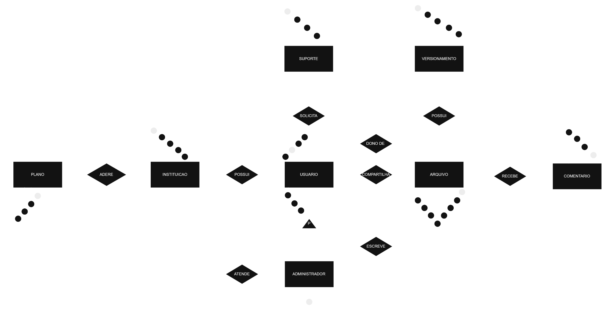
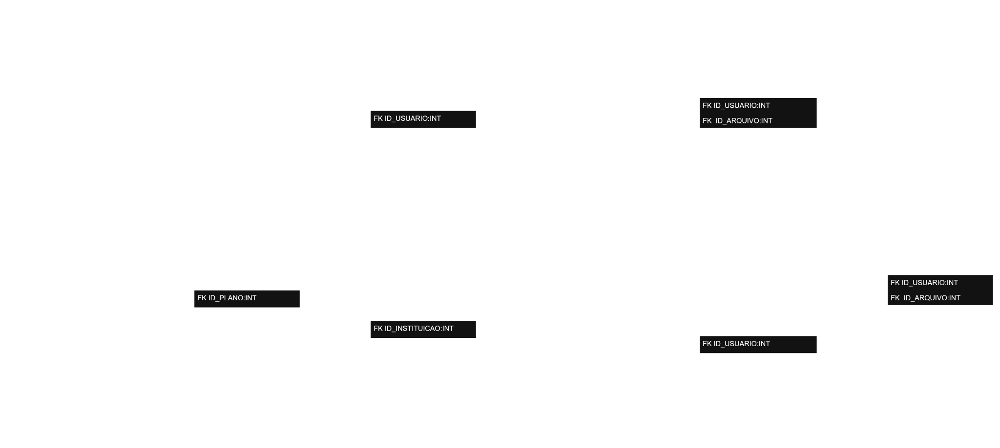

# WebDriver — Banco de Dados

Projeto acadêmico de modelagem e implementação de um sistema de gerenciamento de arquivos, usuários e instituições. Inclui modelos conceitual e lógico, banco de dados MySQL e uma aplicação Python de terminal para administrar cadastros, arquivos, compartilhamentos, suporte e históricos.

## Tecnologias

- **Python 3.10+** — aplicação de terminal e testes automatizados.
- **MySQL 8.0.16+** — armazenamento de dados, relacionamentos, restrições, triggers e procedimentos armazenados.
- **MySQL Connector/Python** — comunicação entre Python e MySQL.
- **MySQL Workbench** — execução e inspeção do modelo físico.
- **`unittest`** — testes automatizados da camada Python.

## Modelagem do banco de dados

### Modelo conceitual



### Modelo lógico



### Modelo físico

O arquivo [`sql/01-modelo-fisico.sql`](sql/01-modelo-fisico.sql) cria o banco `webdriver`, suas tabelas, relacionamentos, restrições, triggers e rotinas armazenadas.

O modelo contempla instituições e planos; usuários e administradores; arquivos e compartilhamentos; comentários e suporte; operações e histórico de versões. Também prevê exclusão lógica de arquivos e regras de acesso e armazenamento.

> **Atenção:** execute o script em um banco novo. Não o reexecute em um banco já populado sem avaliar as consequências, pois objetos existentes podem gerar erros.

## Funcionalidades da aplicação Python

A aplicação funciona pelo **terminal**, com menus para:

| Módulo | Operações disponíveis |
|---|---|
| Planos | Cadastrar, listar, buscar, atualizar e excluir |
| Instituições | Cadastrar, listar, buscar, atualizar e excluir |
| Usuários | Cadastrar, listar, buscar, atualizar e excluir |
| Administradores | Cadastrar, listar, buscar, atualizar e excluir vínculo com usuário |
| Arquivos | Cadastrar, consultar e atualizar metadados; remover logicamente |
| Compartilhamentos | Cadastrar, listar, buscar, atualizar e excluir |
| Comentários | Cadastrar, listar, buscar, atualizar e excluir |
| Suporte | Cadastrar, listar, buscar, atualizar e excluir chamados |
| Atendimentos | Associar, consultar, alterar e remover vínculos entre administradores e chamados |
| Operações e versões | Consultar históricos gerados pelas operações de arquivo |

Os cadastros utilizam consultas SQL parametrizadas. Há validação de campos, confirmação antes de exclusões e tratamento de erros comuns do MySQL. O cadastro de usuários transforma senhas em hashes PBKDF2 com sal aleatório antes de armazená-las; isso **não equivale** a um sistema de autenticação pronto.

As operações em arquivos utilizam os procedimentos `sp_carregar_arquivo`, `sp_atualizar_arquivo` e `sp_remover_arquivo` definidos no modelo físico, para aplicar as regras de cota e registrar o histórico.

## Como executar

### 1. Pré-requisitos

Instale Python 3.10 ou superior, MySQL 8.0.16 ou superior e, se desejar executar o SQL graficamente, MySQL Workbench.

### 2. Prepare o banco

Abra o MySQL Workbench, conecte-se ao servidor MySQL e execute uma única vez o arquivo [`sql/01-modelo-fisico.sql`](sql/01-modelo-fisico.sql) em um ambiente de desenvolvimento novo.

### 3. Crie o ambiente Python

Na raiz do repositório, pelo **PowerShell (Windows)**:

```powershell
python -m venv .venv
.\.venv\Scripts\Activate.ps1
python -m pip install -r requirements.txt
```

No **Linux/macOS**:

```bash
python3 -m venv .venv
source .venv/bin/activate
python -m pip install -r requirements.txt
```

### 4. Configure a conexão

Crie uma cópia local do arquivo `config.example.ini` chamada `config.ini`:

```powershell
Copy-Item .\config.example.ini .\config.ini
```

No Linux/macOS, use `cp config.example.ini config.ini`.

Edite `config.ini` com as credenciais de **sua própria instância** MySQL:

```ini
[mysql]
host = localhost
port = 3306
user = SEU_USUARIO
password = SUA_SENHA
database = webdriver
```

O `config.ini` contém credenciais e está no `.gitignore`: **não o envie ao GitHub**. Cada integrante deve manter a própria configuração local.

### 5. Inicie o sistema

```powershell
python main.py
```

Selecione um módulo no menu e siga as instruções. Para criar registros relacionados, normalmente comece por um **plano**, depois uma **instituição** e, em seguida, os **usuários**.

## Testes

Execute na raiz do projeto:

```powershell
python -m unittest discover -s tests -v
```

A suíte contém **12 testes isolados** que cobrem validações de dados, SQL parametrizado, chaves compostas, transações, consultas de histórico e chamadas de procedimentos. Esses testes passaram na preparação desta documentação, mas **não substituem testes de integração em um servidor MySQL real**.

Para o roteiro detalhado de testes e as limitações de cada módulo, consulte [`docs/crud-python.md`](docs/crud-python.md).

## Estrutura do repositório

```text
Webdriver-database/
├── docs/
│   ├── modelo-conceitual/
│   ├── modelo-logico/
│   ├── entrega-01.md
│   └── crud-python.md
├── sql/
│   └── 01-modelo-fisico.sql
├── tests/
│   └── test_crud.py
├── webdriver/
│   ├── __init__.py
│   ├── arquivos.py
│   ├── catalogo.py
│   ├── conexao.py
│   ├── historicos.py
│   ├── planos.py
│   └── repositorio.py
├── .gitignore
├── config.example.ini
├── main.py
├── requirements.txt
└── README.md
```

## Regras e limitações

- A aplicação é um **console administrativo local**; não há interface gráfica nem autenticação de usuários finais nessa etapa.
- Os IDs informados no terminal são referências a registros; as permissões efetivas dependem da conta MySQL configurada.
- O módulo de arquivos gerencia **metadados** (nome, localização, URL, tamanho e acesso), não faz upload nem guarda o conteúdo binário dos arquivos.
- Exclusões em tabelas relacionadas podem ser bloqueadas por chaves estrangeiras. A exclusão de arquivos é lógica e mantém o histórico.
- As rotinas de arquivos gerenciam as próprias transações. Não devem ser envolvidas em outra transação externa.
- Autenticação de assinantes, views e roles previstas para a **Parte 2** não estão implementadas nesta aplicação.
- A execução completa com banco MySQL, suas permissões e dados de teste deve ser validada no ambiente do grupo.

## Documentação adicional

- [Entrega inicial: conexão MySQL e planos](docs/entrega-01.md)
- [CRUD completo em Python e roteiro de testes](docs/crud-python.md)
- [Modelo físico MySQL](sql/01-modelo-fisico.sql)

### Arquivos editáveis dos diagramas

- [Modelo conceitual no Google Drive](https://drive.google.com/file/d/1purrhiVyhfNTFOg3Qon34gkXQpi7SYsP/view)
- [Modelo lógico no Google Drive](https://drive.google.com/file/d/1WD-crls5wBHvUXtBlZt8xxZJQfTUF5Bc/view)

Os arquivos `.drawio` não estão incluídos neste repositório. Esses links foram informados pelo autor e podem apontar para versões anteriores às imagens publicadas.
